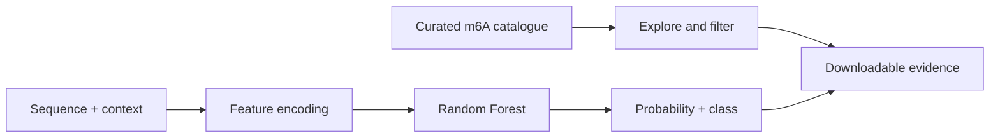

<div align="center">

# m6A Explorer

**An interactive browser and Random Forest predictor for RNA m6A sites**

[](https://github.com/Ci-yo/BIO215_P2_m6A-Shiny/actions/workflows/repository-check.yml)
[](https://xi-yo.shinyapps.io/P6_2255737/)


<sub>One interface for browsing curated sites, exploring feature patterns and making single or batch predictions.</sub>

**[Launch the live m6A Explorer →](https://xi-yo.shinyapps.io/P6_2255737/)**

</div>

## Step-by-step guide

### 1. Download the app

Install [R](https://cran.r-project.org/) (R 4.4+ recommended) and optionally
[RStudio](https://posit.co/download/rstudio-desktop/).
With [Git](https://git-scm.com/downloads) installed, run in a **terminal**:

```bash
git clone https://github.com/Ci-yo/BIO215_P2_m6A-Shiny.git
cd BIO215_P2_m6A-Shiny
```

Or choose **Code → Download ZIP**, extract it, and open the extracted folder.
Keep the `.rds`, `.csv`, `www/` and `app.R` files together.

### 2. Install dependencies and start the app

Open R/RStudio with that folder as the working directory. In the **R console**:

```r
stopifnot(file.exists("app.R"))
source("requirements.R")
shiny::runApp(".", launch.browser = TRUE)
```

The first call installs missing packages. The second starts a local server and
opens the dashboard. Keep R running while using the app; click **Stop** in
RStudio or press **Ctrl+C** in the terminal to end it.
No training step is needed: the model files are included.

### 3. Make your first batch prediction

1. Open **m6A Prediction Multiple** in the sidebar.
2. Click **Example data** to load the bundled input.
3. Leave the probability threshold at `0.5`, then click **Predict**.
4. Check that the table gains `predicted_m6A_prob` and
   `predicted_m6A_status` columns.
5. Click **Download predicted.csv** to save the result.

The class is `Positive` when the unrounded model probability is **strictly
greater than** the threshold. The displayed probability is rounded to three
decimal places, so use the returned status when a value appears tied.

### 4. Try a single site or your own CSV

For one site, open **m6A Prediction Single**, keep the example DNA 5-mer
`GGACA`, adjust the feature controls, and inspect the live probability/status.
Use **Add to compare** followed by **Download compare.csv** to retain cases.

For a batch, start from
[`m6A_input_example.csv`](m6A_input_example.csv) or the **Template CSV** button.
Required column names are case-sensitive:

| Column | Input contract |
|---|---|
| `DNA_5mer` | Exactly five DNA letters from A/T/C/G; use T, not U. |
| `RNA_type` | `mRNA`, `lincRNA`, `lncRNA`, `pseudogene`. |
| `RNA_region` | `CDS`, `intron`, `3'UTR`, `5'UTR`. |
| `gc_content`, `evolutionary_conservation` | Numeric features on the supplied example's scale (typically 0–1). |
| `exon_length`, `distance_to_junction` | Numeric model features on the supplied teaching-data scale. |

Do not assume length/distance fields accept untransformed base-pair values.
The app consumes prepared features; it does not annotate genomic coordinates
or recreate feature preprocessing from a FASTA file. Avoid blank cells.

### 5. Troubleshooting and verification

| Symptom | Action |
|---|---|
| `file.exists("app.R")` is false | In RStudio use **Session → Set Working Directory → Choose Directory** and select this repository. |
| A package is missing | Rerun `source("requirements.R")` in the same R session/library. |
| `rf_fit.rds` is missing | Download the complete repository, not just `app.R`. |
| Missing columns or unknown factor levels | Match the example header and the category spellings above. |
| The hosted app is unavailable | Use this local walkthrough; hosted availability is separate from the repository. |

Optional archive check, in a **terminal** with Python 3.10+:

```bash
python scripts/validate_repository.py
```

This checks files and schemas; the example prediction above checks runtime
behaviour. The app is an educational model demonstration.

## What it does

`m6A Explorer` turns a static teaching dataset into an explorable product. It combines a 48,055-site catalogue with a pre-trained Random Forest model and keeps the analysis path visible rather than hiding it behind a single prediction button.

| Workspace | Capability |
|---|---|
| Data | filter and inspect the curated m6A site table |
| Visualize | explore distributions and transcript-context patterns |
| Batch prediction | upload a table and export scored sites |
| Single prediction | test one 5-mer with its sequence and transcript context |
| Download | export filtered data and prediction results |

## Product flow



The model uses a DNA 5-mer together with GC content, RNA type, RNA region, exon length, junction distance and evolutionary conservation. Predictions are educational demonstrations, not clinical or diagnostic results.

## Repository guide

```text
BIO215_P2_m6A-Shiny/
├── app.R                    complete Shiny UI and server
├── m6A_imbalanced.csv       curated teaching dataset
├── m6A_input_example.csv    batch prediction template
├── rf_fit.rds               trained Random Forest model
├── assets/                  repository preview image
├── www/                     app-native visual asset
└── scripts/                 dependency-free archive check
```

## Design decisions

- The app supports both discovery and prediction, so the model remains connected to the underlying data.
- Batch and single-input modes share one model and one feature schema.
- Export controls make each exploration path reproducible outside the dashboard.
- Only runtime files are published; draft reports, R workspace state and deployment metadata stay outside this repository.

Run the same structural check used by GitHub Actions with:

```bash
python scripts/validate_repository.py
```

> **Academic-use note**  
> This is a completed coursework portfolio project. Reuse the ideas with attribution and follow your institution's academic-integrity rules.
