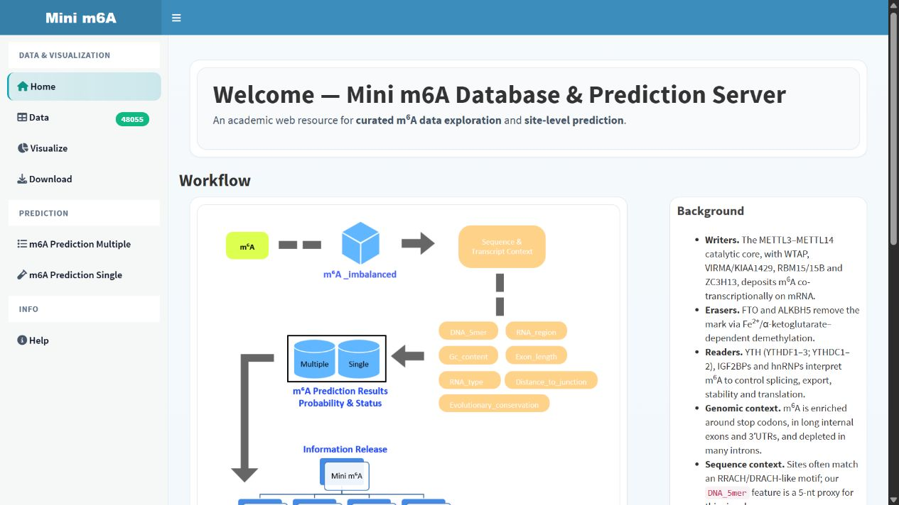
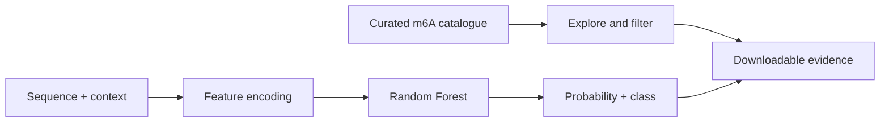

<div align="center">

# m6A Explorer

**An interactive browser and Random Forest predictor for RNA m6A sites**

[](https://github.com/Ci-yo/BIO215_P2_m6A-Shiny/actions/workflows/repository-check.yml)
[](https://xi-yo.shinyapps.io/P6_2255737/)




<sub>One interface for browsing curated sites, exploring feature patterns and making single or batch predictions.</sub>

**[Launch the live m6A Explorer →](https://xi-yo.shinyapps.io/P6_2255737/)**

</div>

## What it does

`m6A Explorer` turns a static teaching dataset into an explorable product. It combines a 48,055-site catalogue with a pre-trained Random Forest model and keeps the analysis path visible rather than hiding it behind a single prediction button.

| Workspace | Capability |
|---|---|
| Data | filter and inspect the curated m6A site table |
| Visualize | explore distributions and transcript-context patterns |
| Batch prediction | upload a table and export scored sites |
| Single prediction | test one 5-mer with its sequence and transcript context |
| Download | export filtered data and prediction results |

## Product flow



The model uses a DNA 5-mer together with GC content, RNA type, RNA region, exon length, junction distance and evolutionary conservation. Predictions are educational demonstrations, not clinical or diagnostic results.

## Run locally

```r
install.packages(c(
  "shiny", "shinydashboard", "DT", "ggplot2",
  "dplyr", "randomForest", "fresh"
))
shiny::runApp()
```

Open the repository as the working directory before running the app. A batch-input template is included as `m6A_input_example.csv`.

## Repository guide

```text
BIO215_P2_m6A-Shiny/
├── app.R                    complete Shiny UI and server
├── m6A_imbalanced.csv       curated teaching dataset
├── m6A_input_example.csv    batch prediction template
├── rf_fit.rds               trained Random Forest model
├── assets/                  repository preview image
├── www/                     app-native visual asset
└── scripts/                 dependency-free archive check
```

## Design decisions

- The app supports both discovery and prediction, so the model remains connected to the underlying data.
- Batch and single-input modes share one model and one feature schema.
- Export controls make each exploration path reproducible outside the dashboard.
- Only runtime files are published; draft reports, R workspace state and deployment metadata stay outside this repository.

Run the same structural check used by GitHub Actions with:

```bash
python scripts/validate_repository.py
```

> **Academic-use note**  
> This is a completed coursework portfolio project. Reuse the ideas with attribution and follow your institution's academic-integrity rules.
